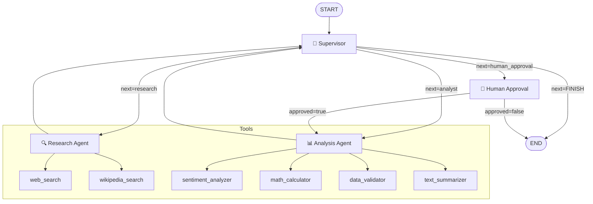

# Multi-Agent Orchestrator — API de Producción

Orquestador multi-agente construido con [LangGraph](https://github.com/langchain-ai/langgraph) que coordina un **Agente de Investigación** y un **Agente de Análisis** bajo el control de un **Supervisor** central.

La **Entrega 7** extiende el sistema del Módulo 6 con una **API REST asíncrona** (FastAPI), **persistencia de estado en Redis**, **observabilidad** (LangSmith / Arize Phoenix) y un nodo de **aprobación humana** (Human-in-the-Loop) que pausa la ejecución ante tareas críticas.

---

## Arquitectura

### Grafo multi-agente



### Capa de API

```
Cliente
  │
  ▼
POST /tasks ──► FastAPI (BackgroundTask + run_in_threadpool)
                    │
                    ▼
              worker.py ──► LangGraph graph ──► RedisSaver (checkpoints)
                    │              │
                    ▼              ▼
              Redis                LangSmith / Phoenix (trazas)
           (job state)
```

### Nodos del grafo

| Nodo | Rol |
|------|-----|
| **Supervisor** | Lee el estado actual, decide la siguiente acción (research / analyst / human_approval / FINISH) y valida la calidad de los resultados. Fuerza FINISH tras `MAX_ITERATIONS`. |
| **Research Agent** | Agente ReAct con `web_search` y `wikipedia_search`. Recopila información factual sobre la consulta. |
| **Analysis Agent** | Agente ReAct con `sentiment_analyzer`, `math_calculator`, `data_validator` y `text_summarizer`. Transforma los hallazgos en conclusiones. |
| **Human Approval** | Llama a `interrupt()` de LangGraph para pausar el grafo. Se activa cuando la consulta contiene keywords de alto riesgo (deploy, delete, execute, etc.). |

### Componentes de la API

| Archivo | Responsabilidad |
|---------|----------------|
| `app/main.py` | FastAPI: endpoints asíncronos, nunca bloquea el event loop |
| `app/graph.py` | Grafo extendido con HITL routing y RedisSaver checkpointer |
| `app/worker.py` | Ejecuta el grafo en un threadpool, persiste estados en Redis |
| `app/observability.py` | Inicializa LangSmith o Arize Phoenix |
| `app/hitl.py` | Nodo `human_approval` con `interrupt()` + routing post-decisión |

---

## Flujo de ejecución

1. `POST /tasks` → crea job en Redis (estado `PENDING`), retorna `job_id` inmediatamente
2. Worker inicia en background → estado `RUNNING`
3. `START → Supervisor` → primera decisión: normalmente "investigar"
4. `Supervisor → Research` → recopila información
5. `Research → Supervisor` → evalúa: ¿es suficiente?
6. Si la consulta es crítica → `Supervisor → Human Approval` → estado `AWAITING_APPROVAL`
7. Operador envía `POST /tasks/{id}/approve` → el grafo se reanuda
8. `Supervisor → Analyst` → analiza los hallazgos
9. `Analyst → Supervisor` → evalúa: ¿está completo?
10. `Supervisor → END` → estado `DONE`, resultado guardado en Redis

---

## Estructura del proyecto

```
├── app/
│   ├── main.py            # FastAPI: POST /tasks · GET /tasks/{id} · POST /tasks/{id}/approve
│   ├── graph.py           # Grafo con HITL routing + RedisSaver checkpointer
│   ├── worker.py          # Ejecución en background, estados PENDING/RUNNING/DONE/FAILED
│   ├── observability.py   # Init LangSmith / Arize Phoenix
│   └── hitl.py            # Nodo human_approval: interrupt() + routing post-aprobación
├── agents/
│   ├── supervisor.py      # Supervisor: decisión + validación de calidad
│   ├── research_agent.py  # Research Agent + research_node
│   └── analyst_agent.py   # Analysis Agent + analyst_node
├── tools/
│   ├── search_tools.py    # web_search, wikipedia_search
│   └── analysis_tools.py  # sentiment_analyzer, math_calculator, data_validator, text_summarizer
├── tests/
│   ├── test_state.py
│   ├── test_tools.py
│   ├── test_agents.py
│   └── test_graph.py
├── state.py               # OrchestratorState TypedDict (+ is_critical, is_approved)
├── config.py              # Factory de LLM (anthropic / openai / ollama)
├── main.py                # CLI interactivo (Módulo 6, sin cambios)
├── load_test.py           # Prueba de carga: 5 peticiones concurrentes
├── docker-compose.yml     # API + Redis en un solo comando
├── Dockerfile
├── requirements.txt
├── .env.example
├── screenshots/           # Capturas del dashboard de observabilidad
└── README.md
```

---

## Prerrequisitos

- Python 3.12+
- Redis 7+ (local o vía Docker)
- Una clave de API de Anthropic, OpenAI u Ollama corriendo localmente
- *(Opcional)* Clave de Tavily para búsqueda web real
- *(Opcional)* Clave de LangSmith para observabilidad

---

## Setup — Opción A: sin Docker

### 1. Clonar el repositorio

```bash
git clone https://github.com/ctorres014/Orquestador-multi-agente-especializado.git
cd Orquestador-multi-agente-especializado
git checkout entrega7
```

### 2. Crear entorno virtual e instalar dependencias

```bash
python -m venv .venv
source .venv/bin/activate        # macOS / Linux
# .venv\Scripts\activate         # Windows

pip install -r requirements.txt
```

### 3. Configurar variables de entorno

```bash
cp .env.example .env
```

Abrí `.env` y completá como mínimo:

```env
# LLM — elegí uno
LLM_PROVIDER=anthropic
ANTHROPIC_API_KEY=sk-ant-...

# Redis
REDIS_URL=redis://localhost:6379

# Observabilidad — LangSmith (recomendado)
LANGCHAIN_TRACING_V2=true
LANGCHAIN_API_KEY=ls__...
LANGCHAIN_PROJECT=entrega7-multi-agent
```

### 4. Levantar Redis

```bash
# Con Docker (recomendado — no requiere instalación):
docker run -d --name redis -p 6379:6379 redis:7-alpine

# O con Redis instalado localmente:
redis-server
```

Verificar que Redis responde:

```bash
redis-cli ping   # → PONG
```

### 5. Iniciar la API

```bash
uvicorn app.main:app --reload
```

La API queda disponible en:
- **API:** `http://localhost:8000`
- **Docs interactivos (Swagger):** `http://localhost:8000/docs`
- **ReDoc:** `http://localhost:8000/redoc`

---

## Setup — Opción B: Docker Compose

Levanta Redis y la API juntos en un solo comando:

```bash
cp .env.example .env   # completá con tus claves
docker compose up --build
```

Para detenerlo:

```bash
docker compose down
```

---

## Uso de la API

### Enviar una tarea

```bash
curl -s -X POST http://localhost:8000/tasks \
  -H "Content-Type: application/json" \
  -d '{"query": "What is machine learning?"}' | jq
```

Respuesta inmediata — la tarea se encola y el servidor **no bloquea**:

```json
{
  "job_id": "3f8a2c1d-...",
  "status": "pending",
  "message": "Task enqueued. Poll GET /tasks/{job_id} for status."
}
```

### Consultar el estado de una tarea

```bash
curl -s http://localhost:8000/tasks/3f8a2c1d-... | jq
```

Respuesta cuando termina:

```json
{
  "job_id": "3f8a2c1d-...",
  "status": "done",
  "query": "What is machine learning?",
  "result": {
    "research_data": "...",
    "analysis_result": "...",
    "agent_contributions": { "research": "...", "analyst": "..." },
    "iteration_count": 3,
    "task_completed": true
  },
  "created_at": "2024-10-12T18:00:00Z",
  "updated_at": "2024-10-12T18:02:15Z"
}
```

| Estado | Significado |
|--------|-------------|
| `pending` | Encolado, aún no iniciado |
| `running` | El grafo está ejecutándose |
| `awaiting_approval` | Pausado en HITL, esperando aprobación humana |
| `done` | Completado exitosamente |
| `rejected` | El humano rechazó la tarea en el nodo HITL |
| `failed` | Error durante la ejecución (detalle en campo `error`) |

### Aprobar / rechazar una tarea crítica (HITL)

Las consultas que contienen keywords como `deploy`, `delete`, `execute`, `publish`,
`send email`, `purchase`, `update database`, etc. se pausan automáticamente.
El status pasa a `awaiting_approval` y el campo `interrupt_value` muestra el contexto.

```bash
# Aprobar → el grafo continúa hacia el agente analista
curl -s -X POST http://localhost:8000/tasks/3f8a2c1d-.../approve \
  -H "Content-Type: application/json" \
  -d '{"approved": true}' | jq

# Rechazar → el grafo finaliza sin analizar
curl -s -X POST http://localhost:8000/tasks/3f8a2c1d-.../approve \
  -H "Content-Type: application/json" \
  -d '{"approved": false}' | jq
```

### Health check

```bash
curl http://localhost:8000/health
```

```json
{
  "status": "ok",
  "redis": "connected",
  "graph": "compiled"
}
```

---

## CLI del Módulo 6

El orquestador original sigue funcionando sin cambios:

```bash
# Modo interactivo
python main.py

# Consulta única
python main.py --query "What is quantum computing?"

# Salida detallada con streaming
python main.py --query "Analyze AI regulation" --verbose
```

---

## Observabilidad

### LangSmith (recomendado — sin instalación extra)

Agregá estas variables a `.env`:

```env
LANGCHAIN_TRACING_V2=true
LANGCHAIN_API_KEY=ls__...
LANGCHAIN_PROJECT=entrega7-multi-agent
```

LangChain instrumenta automáticamente todas las llamadas al LLM y cada nodo
del grafo. Las trazas aparecen en `https://smith.langchain.com`.

### Arize Phoenix (alternativa local)

```bash
pip install arize-phoenix openinference-instrumentation-langchain
```

```env
PHOENIX_ENABLED=true
```

Dashboard disponible en `http://localhost:6006` cuando la API está corriendo.

---

## Prueba de carga — 5 peticiones concurrentes

```bash
python load_test.py
```

El script envía 5 consultas en paralelo, hace polling hasta que todas terminan
y reporta la latencia p95:

```
==============================
  Load test — 5 concurrent requests
  Started at 2024-10-12T18:00:00
==============================

[1/5] Submitting: What is machine learning...
[1/5] job_id=3f8a2c1d-...
...
==============================
  All tasks finished in 124.3s
  p95 latency : 118.2s
  avg latency : 95.4s
  max latency : 124.3s
  Results saved to load_test_results.json
```

**Capturar métricas del dashboard (evidencia requerida):**

1. Abrí `https://smith.langchain.com` → proyecto **entrega7-multi-agent**
2. En la pestaña **Runs** vas a ver las 5 trazas generadas
3. Capturá:
   - Vista general con las 5 trazas (`langsmith_traces_overview.png`)
   - Una traza expandida con todos los nodos (`langsmith_single_trace.png`)
   - Costo por ejecución en tokens/USD (`langsmith_cost_per_run.png`)
   - Latencia p95 del dashboard (`langsmith_p95_latency.png`)
4. Guardá las capturas en `screenshots/`

---

## Proveedores LLM

### Anthropic (default)

```env
LLM_PROVIDER=anthropic
ANTHROPIC_API_KEY=sk-ant-...
ANTHROPIC_MODEL=claude-3-5-sonnet-20241022
```

### OpenAI

```env
LLM_PROVIDER=openai
OPENAI_API_KEY=sk-...
OPENAI_MODEL=gpt-4o-mini
```

### Ollama (local, sin clave de API)

```bash
# Instalar y levantar Ollama
ollama serve

# Descargar un modelo
ollama pull llama3.2
```

```env
LLM_PROVIDER=ollama
OLLAMA_BASE_URL=http://localhost:11434
OLLAMA_MODEL=llama3.2
```

---

## Variables de entorno — referencia completa

| Variable | Default | Descripción |
|----------|---------|-------------|
| `LLM_PROVIDER` | `anthropic` | Backend LLM: `anthropic`, `openai`, `ollama` |
| `ANTHROPIC_API_KEY` | — | Clave de Anthropic |
| `ANTHROPIC_MODEL` | `claude-3-5-sonnet-20241022` | Modelo de Anthropic |
| `OPENAI_API_KEY` | — | Clave de OpenAI |
| `OPENAI_MODEL` | `gpt-4o-mini` | Modelo de OpenAI |
| `OLLAMA_BASE_URL` | `http://localhost:11434` | URL del servidor Ollama |
| `OLLAMA_MODEL` | `llama3.2` | Modelo de Ollama |
| `TAVILY_API_KEY` | — | Clave Tavily Search (sin ella, búsqueda simulada) |
| `REDIS_URL` | `redis://localhost:6379` | Conexión a Redis |
| `JOB_TTL_SECONDS` | `86400` | TTL de jobs en Redis (24 h) |
| `LANGCHAIN_TRACING_V2` | `false` | Activar trazas LangSmith |
| `LANGCHAIN_API_KEY` | — | Clave de LangSmith |
| `LANGCHAIN_PROJECT` | `entrega7-multi-agent` | Proyecto en LangSmith |
| `PHOENIX_ENABLED` | `false` | Activar Arize Phoenix |
| `MAX_ITERATIONS` | `6` | Iteraciones máximas del supervisor |

---

## Tests

```bash
# Todos los tests
pytest tests/ -v

# Un archivo específico
pytest tests/test_tools.py -v
pytest tests/test_graph.py -v

# Con reporte de cobertura
pytest tests/ --cov=. --cov-report=term-missing
```

| Archivo | Qué prueba |
|---------|-----------|
| `test_state.py` | Schema de OrchestratorState, tipos de campos |
| `test_tools.py` | Las 6 herramientas, casos borde, mocking |
| `test_agents.py` | Creación de agentes, nodos, decisiones del supervisor |
| `test_graph.py` | Construcción del grafo, nodos, topología, invocación |

---

## Racionalidad del diseño

### ¿Por qué Supervisor jerárquico?

El patrón de **supervisor jerárquico** fue elegido sobre alternativas (fan-out paralelo, cadena secuencial, round-robin) por:

1. **Routing dinámico**: el supervisor puede decidir saltear la investigación (para consultas puramente matemáticas) o solicitar una segunda pasada antes del análisis.
2. **Validación de calidad**: revisa los outputs de los agentes y puede solicitar correcciones antes de continuar.
3. **Punto único de terminación**: centralizar la decisión FINISH en un nodo evita condiciones de carrera y garantiza que el loop siempre termine.
4. **Extensibilidad**: agregar un tercer agente (ej. "escritor") requiere solo registrar el nodo y añadir edges al supervisor.

### ¿Por qué BackgroundTasks en lugar de Celery?

Para el alcance de este proyecto, `BackgroundTasks` + `run_in_threadpool` es suficiente y elimina la dependencia de un message broker externo. El grafo LangGraph es sincrónico por diseño; correrlo en un thread pool del event loop de asyncio resuelve el problema de bloqueo sin overhead adicional.

### ¿Por qué `interrupt()` para HITL?

`interrupt()` de LangGraph checkpointea el estado completo antes de pausar. Cuando el operador aprueba vía `Command(resume=...)`, el grafo retoma exactamente desde donde estaba, con todo el contexto previo intacto. Esto es más robusto que almacenar el estado manualmente y re-crear el grafo.

---

## Licencia

MIT
