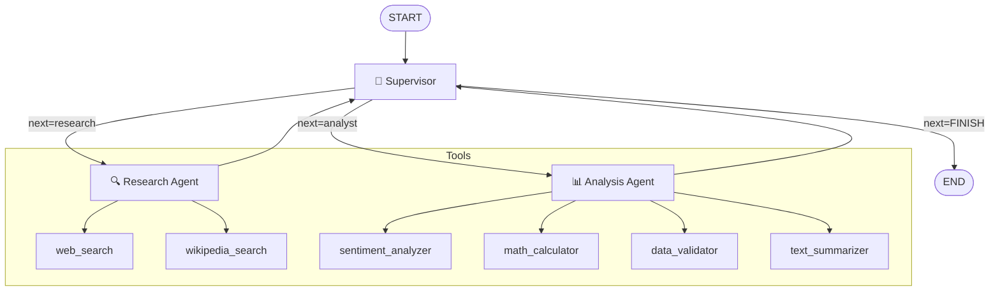

# Multi-Agent Orchestrator with LangGraph

A production-ready multi-agent pipeline built with [LangGraph](https://github.com/langchain-ai/langgraph) that coordinates a **Research Agent** and an **Analysis Agent** under the control of a central **Supervisor**. The system supports three LLM backends (Anthropic, OpenAI, Ollama) and provides graceful fallbacks for all optional external services.

---

## Architecture

The orchestrator follows a **hierarchical supervisor pattern**: a single Supervisor node acts as the central decision-maker, dispatching work to specialized agents and validating results before finishing.



### Nodes

| Node | Role |
|---|---|
| **Supervisor** | Reads current state, decides next action (research / analyst / FINISH), validates output quality. Forces FINISH after `MAX_ITERATIONS` to prevent infinite loops. |
| **Research Agent** | ReAct agent with `web_search` and `wikipedia_search` tools. Gathers factual information about the query. |
| **Analysis Agent** | ReAct agent with `sentiment_analyzer`, `math_calculator`, `data_validator`, and `text_summarizer` tools. Transforms research findings into insights. |

### Flow

1. `START → Supervisor` — first decision: usually "go research"
2. `Supervisor → Research` — gather information
3. `Research → Supervisor` — evaluate: "is this enough?"
4. `Supervisor → Analyst` — analyze what was found
5. `Analyst → Supervisor` — evaluate: "is this complete?"
6. `Supervisor → END` — return final state

---

## File Structure

```
Entrega6/
├── state.py              # OrchestratorState TypedDict
├── config.py             # LLM provider factory (get_llm)
├── graph.py              # LangGraph StateGraph definition
├── main.py               # Interactive CLI & run_query() API
├── agents/
│   ├── __init__.py
│   ├── research_agent.py # Research Agent + research_node
│   ├── analyst_agent.py  # Analysis Agent + analyst_node
│   └── supervisor.py     # Supervisor node + route_supervisor
├── tools/
│   ├── __init__.py
│   ├── search_tools.py   # web_search, wikipedia_search
│   └── analysis_tools.py # sentiment_analyzer, math_calculator,
│                         # data_validator, text_summarizer
├── tests/
│   ├── test_state.py
│   ├── test_tools.py
│   ├── test_agents.py
│   └── test_graph.py
├── demo_notebook.ipynb
├── .env.example
├── requirements.txt
└── README.md
```

---

## Setup

### 1. Clone / Navigate to the project

```bash
cd Entrega6
```

### 2. Create a virtual environment

```bash
python -m venv .venv
source .venv/bin/activate        # Linux/macOS
# .venv\Scripts\activate         # Windows
```

### 3. Install dependencies

```bash
pip install -r requirements.txt
```

### 4. Configure environment variables

```bash
cp .env.example .env
# Edit .env with your actual API keys
```

---

## Usage

### Interactive CLI

```bash
python main.py
```

Example session:
```
=== Multi-Agent Orchestrator ===
LLM Provider: anthropic
Model: claude-3-5-sonnet-20241022

Query> What is the current state of AI regulation in the EU?
```

### Single query (non-interactive)

```bash
python main.py --query "What are the economic impacts of climate change?"
```

### Verbose / streamed output

```bash
python main.py --query "Analyze AI regulation" --verbose
```

### Programmatic API

```python
from dotenv import load_dotenv
load_dotenv()

from main import run_query

result = run_query("What is quantum computing?")
print(result["analysis_result"])
print(result["agent_contributions"])
```

---

## LLM Provider Examples

### Anthropic (default)

```env
LLM_PROVIDER=anthropic
ANTHROPIC_API_KEY=sk-ant-...
ANTHROPIC_MODEL=claude-3-5-sonnet-20241022
```

### OpenAI

```env
LLM_PROVIDER=openai
OPENAI_API_KEY=sk-...
OPENAI_MODEL=gpt-4o-mini
```

### Ollama (local, no API key needed)

```bash
# Start Ollama server
ollama serve

# Pull a model
ollama pull llama3.2
```

```env
LLM_PROVIDER=ollama
OLLAMA_BASE_URL=http://localhost:11434
OLLAMA_MODEL=llama3.2
```

---

## Topology Rationale

### Why a Hierarchical Supervisor Pattern?

The **hierarchical supervisor** pattern was chosen over alternatives (parallel fan-out, sequential chain, round-robin) for the following reasons:

1. **Dynamic routing**: The supervisor can decide whether research is needed at all (e.g., if the query is purely mathematical), or whether a second research pass is required before analysis.

2. **Quality validation**: The supervisor reviews agent outputs before proceeding, enabling it to detect incomplete or off-topic responses and request remediation.

3. **Single source of truth for termination**: By centralizing the FINISH decision in one node, we avoid race conditions and ensure the loop always terminates. The `MAX_ITERATIONS` guard is the hard stop.

4. **Extensibility**: Adding a third agent (e.g., a "writer" agent) requires only: registering a new node + adding edges to/from the supervisor. No existing nodes change.

### How Agent Conflicts Are Handled

When the Research Agent and Analysis Agent produce contradictory or incomplete information:

- The **Supervisor** receives a summary of both outputs and must choose the next action. If outputs are inconsistent, it can re-dispatch to the same or a different agent with clarifying instructions via the `messages` list.
- Both agents' outputs are preserved in `agent_contributions` (additive merging — new contributions never overwrite prior ones).
- `validation_notes` in the state lets the supervisor communicate concerns to subsequent agents.
- The `MAX_ITERATIONS` ceiling (`default: 6`) guarantees the system never loops forever, even if agents keep producing unsatisfactory results.

---

## Testing

### Run all tests

```bash
pytest tests/ -v
```

### Run a specific test file

```bash
pytest tests/test_tools.py -v
pytest tests/test_graph.py -v
```

### Test coverage report

```bash
pytest tests/ --cov=. --cov-report=term-missing
```

### Test categories

| File | What it tests |
|---|---|
| `test_state.py` | OrchestratorState schema, field types, instantiation |
| `test_tools.py` | All 6 tools, edge cases, error handling, mocking |
| `test_agents.py` | Agent creation, node functions, supervisor decisions, routing |
| `test_graph.py` | Graph build, node presence, edge topology, invocation |

---

## Environment Variables Reference

| Variable | Default | Description |
|---|---|---|
| `LLM_PROVIDER` | `anthropic` | LLM backend: `anthropic`, `openai`, or `ollama` |
| `ANTHROPIC_API_KEY` | — | Anthropic API key |
| `ANTHROPIC_MODEL` | `claude-3-5-sonnet-20241022` | Anthropic model name |
| `OPENAI_API_KEY` | — | OpenAI API key |
| `OPENAI_MODEL` | `gpt-4o-mini` | OpenAI model name |
| `OLLAMA_BASE_URL` | `http://localhost:11434` | Ollama server URL |
| `OLLAMA_MODEL` | `llama3.2` | Ollama model name |
| `TAVILY_API_KEY` | — | Tavily Search API key (optional) |
| `MAX_ITERATIONS` | `6` | Max supervisor iterations before forced FINISH |

---

## License

MIT
